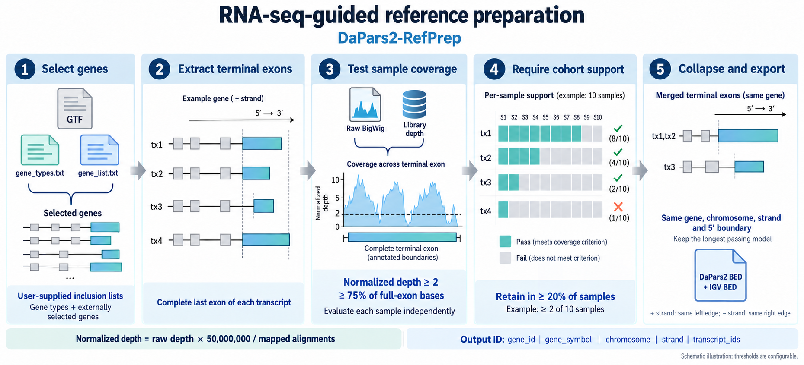

# DaPars2-RefPrep

RNA-seq-guided reference preparation for [DaPars2](https://github.com/3UTR/DaPars2).

This fork adds a standalone tool that selects annotated terminal exons using gene lists and actual RNA-seq coverage, then collapses supported models into a DaPars2-compatible reference. The original DaPars2 quantification scripts, legacy annotation extractor, test dataset and license are retained unchanged.

## Prepare a reference

Requires Python 3.8 or newer. Install the reference builder's dependencies:

```bash
python -m pip install -r requirements-reference.txt
```

Provide a GTF, two single-column selection lists, and a sample table:

- `gene_types.txt`: gene types to retain, such as `protein_coding`.
- `gene_list.txt`: gene IDs selected externally, for example by an expression filter. This tool does not read expression matrices or impose an expression threshold.
- `samples.tsv`: tab-separated columns `sample_id`, `bigwig`, `mapped_alignments`. BigWigs must contain **raw, unnormalized, unstranded per-base coverage**. Relative paths are resolved from this table's directory.

```bash
python src/DaPars2_Build_Reference.py \
  --gtf annotation.gtf.gz \
  --gene-types gene_types.txt \
  --gene-list gene_list.txt \
  --samples samples.tsv \
  --output-prefix results/reference \
  --workers 4
```

Defaults retain a model when at least **75% of its complete terminal-exon bases** have coverage **at least 2 per 50 million mapped alignments**, in **at least 20% of samples**. All three thresholds can be changed. Gene/locus identities and distinct transcriptional 5′ boundaries remain separate; the longest passing model and all passing transcript IDs are retained within each group.

Output names use `gene_id|gene_symbol|chromosome|strand|transcript_ids`, preserving original gene/transcript versions and joining transcripts with commas.

| Output | Purpose |
| --- | --- |
| `reference.dapars2.bed` | Input to DaPars2; follows its legacy `start0+1,end0` convention |
| `reference.full_exon.igv.bed` | The same regions in standard 0-based, half-open BED coordinates for IGV/bedtools |
| `reference.regions.tsv.gz` | Collapsed region metadata, transcript membership and coverage support |
| `reference.terminal_models.tsv.gz` | All selected terminal-exon models and their coverage decisions |
| `reference.summary.tsv` | Selection counts and analysis thresholds |

Set `Annotated_3UTR=results/reference.dapars2.bed` in the existing DaPars2 configuration. The reference builder reads BigWigs; the upstream quantifier still uses its original coverage inputs and configuration.

See the [input and method guide](docs/reference_preparation.md), [input templates](examples/reference_preparation/), and [validation notes](docs/validation.md). The templates contain illustrative paths; supply your own annotation and coverage files.

## Validation

Run the included synthetic implementation checks:

```bash
python -m unittest discover -s tests -v
```

These check normalization, fraction boundaries, full-exon selection, both strands, gene separation, transcript membership, both coordinate formats, and serial/parallel agreement. Real-cohort comparisons are described separately in the validation notes.

## Original DaPars2

DaPars2 infers proximal polyadenylation sites and PDUI from multiple RNA-seq samples. Its original dependencies and quantification procedure are unchanged; installing the reference-builder requirements does not replace the upstream setup instructions.

- [Upstream documentation](https://github.com/3UTR/DaPars2/wiki)
- [Original README, preserved with citations and contact information](docs/UPSTREAM_README.md)
- [Original license](LICENSE)

Please retain the original DaPars2 citations when using this fork:

- Feng X, Li L, Wagner EJ, Li W. TC3A: The Cancer 3′ UTR Atlas. *Nucleic Acids Research* (2018).
- Li L, Huang K, Gao YP, et al. An atlas of alternative polyadenylation quantitative trait loci contributing to complex trait and disease heritability. *Nature Genetics* (2021). DOI: [10.1038/s41588-021-00864-5](https://doi.org/10.1038/s41588-021-00864-5).
